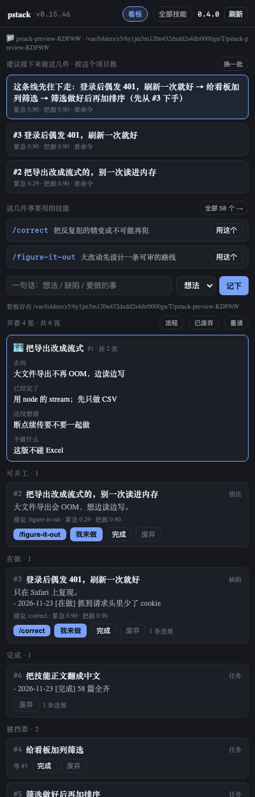
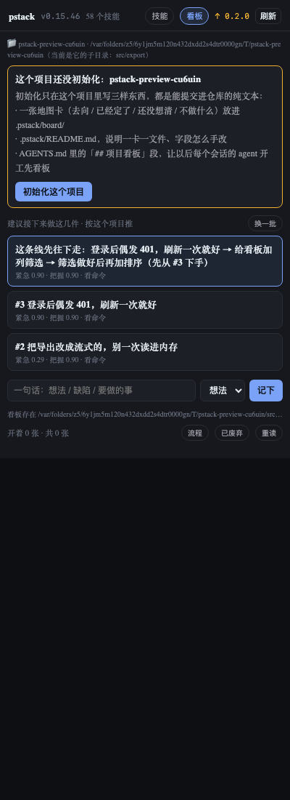
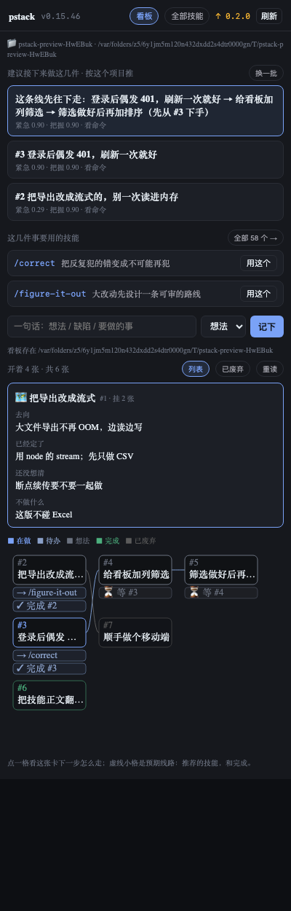
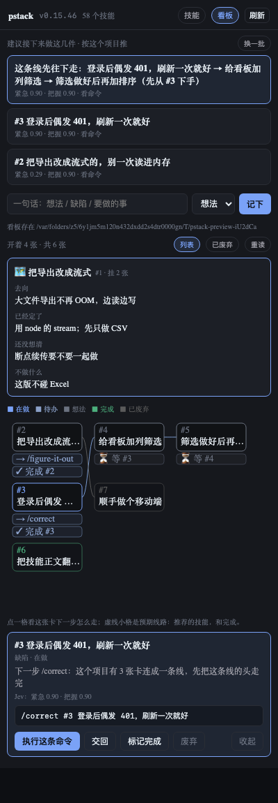
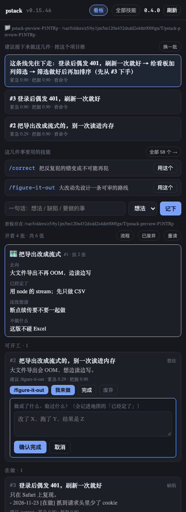
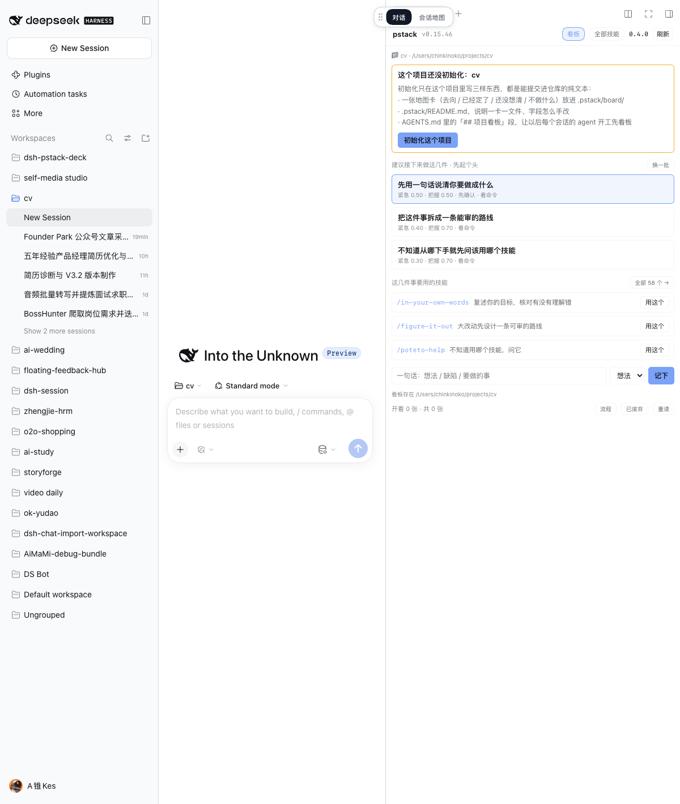

# dsh-pstack-deck

把 [pstack](https://github.com/backnotprop/pstack) 的 58 个技能做成 **DeepSeek Harness（DSH）** 的右栏面板：点一下就注入，不用记名字。再往前一步，它还是一个**项目看板**——多任务并行时告诉你哪张卡现在能开工、谁在做、会不会打架、下一步该用哪个技能。


- 插件名：`dsh-pstack-deck`
- 宿主：DSH（Web 与桌面都行）
- 上游技能：pstack `c3464c1`（快照见 [repo/UPSTREAM.md](repo/UPSTREAM.md)）

---

## 截图

右栏面板。下面这些是用 `npm run preview` 把真面板渲染成 HTML 再截的，不是手画的示意图。

**打开就是看板** —— 不是技能清单。第一屏先回答「这个项目现在该干什么」：3~5 条带现成提示词的建议，加上这几件事要用的技能；技能清单是第二级入口（右上角「全部技能」）。



**技能列表** —— 58 个技能按六组排，带中文一句话；标题栏会自己问 npm 有没有新版本。


**技能详情** —— 中文正文，可一键切回英文原文，底部直接「放进输入框」。


**项目还没初始化** —— 面板顶部先告诉你板在哪个项目、当前是不是它的子目录，然后给一张初始化卡，点一下就把三样东西写进这个项目。



**项目看板** —— 顶部是 3~5 条带现成提示词的建议，下面按「可开工 / 在做 / 完成 / 被挡着」分组，每张卡带推荐技能、紧急度与把握。


**依赖流程图** —— 一列一层，箭头是「先做 → 再做」；每个没做完的节点下面挂着两格虚线：推荐的下一步技能，和「完成」。



**点节点下钻** —— 状态、认领人、动哪些路径、等谁、下一步技能与理由、可直接粘的命令。



**收尾必须写结论** —— 点「完成」不是改个状态，而是先回答「做成了什么、验过什么」；空着点确认会被拦住。写完这句话会同时进卡的 `## 结论` 和地图的「已经定了」。



**真宿主** —— 起一个真 DSH 实例、真浏览器点开的右栏，不是渲染稿：打开就是看板，项目名与板路径在顶上。



---

## pstack 是什么

**一句话：它不是新模型，是装进你已经在用的 AI 编程工具里的一包做事规矩。**

模型还是那个模型（Claude、GPT、随便哪个）。变的是它做事的**顺序和标准**：先搞懂，再动手，改完自己检查一遍才回话。

pstack 由 poteto 写就——React 核心团队出身，在 Cursor 期间写下它，现在做 Grok Bot。它把自己每天写代码用的那套东西抽成了一包可安装的技能，免费开源。

它要治的是这四个毛病：

- **没读懂就改。** 改在看着对、其实不对的地方。
- **只治表面。** 在显示的地方去掉重复数据，产生重复的 bug 还在。
- **没试过就说做完了。** 它说「应该没问题了」，你一跑还是坏的。
- **越改越多。** 加一堆用不上的代码，下一个 bug 就藏在里面。

装进去的东西分三层：

| 层 | 数量 | 是什么 |
|---|---|---|
| **剧本**（playbook） | 22 套 | 每类任务一套做法：修 bug、加功能、重构、追查故障…… |
| **技能**（skill） | 34 个 | 单点动作：`how` 讲清代码、`bro` 翻成大白话、`interrogate` 挑刺 |
| **原则**（principle） | 24 条 | 判断标准：「先删再加」「证明它能用」「改调用方而不是加兼容层」 |

加起来 58 个技能条目（34 个动作 + 24 条原则），装在这一份仓库里。

**适合谁：** 用 AI 做过东西、被「已完成但其实没好」坑过的人；想要做对，不在乎慢一点。
**先别用：** 改错别字、换个颜色这种小事直接跟 AI 说就行；只要最快最省额度也别用，pstack 会多检查，更慢也更费 token。

## pstack 怎么用

### 在 Claude Code / Cursor / Codex 里

**Claude Code**（插件市场）：

```
/plugin marketplace add cursor/plugins
/plugin install pstack@cursor-plugins
```

命令挂在 `pstack:` 下面，所以是 `/pstack:poteto-mode`，只打 `/poteto-mode` 不认。

**Cursor**：对话框里发 `/add-plugin pstack`，命令保持原样，不用前缀。

**Codex 和其他**（`npx skills`，需要 Node.js 22.20+）：

```bash
npx skills add backnotprop/pstack        # 装进当前项目
npx skills add backnotprop/pstack -g     # 装到全局，所有项目都能用
```

装完开一个**新对话**，输入 `/` 看到 `poteto-mode` 就是成了。项目级安装落在 `<项目>/.dsh/skills/` 或 `.agents/skills/`，全局落在 `~/.dsh/skills/`。

### 在 DSH 里

用本插件（见下一节）。它做的是同一件事，只是把 58 个技能摆成能点的面板，并把看板、依赖拓扑一起给你。

### 平时只用记住一个命令

```
/pstack:poteto-mode
```

你说目标（加上怎么算做完），它安排剩下的。比如：

> 先复现这个 bug，再修，修完给我看证据。

不用记那 58 个名字。不知道学哪个就先问 `/pstack:poteto-help`，它只回答问题，不会开始干活。

## pstack 的执行原理

pstack 每接一件事，走固定的四步。它的价值全在这个顺序里，不在某一句话写得聪明。

```
你说一句话（目标 + 怎么算做完）
        │
        ▼
① 匹配：poteto-mode 从 22 套剧本里挑一套
        │   把剧本的步骤原样抄进待办清单，不改写
        ▼
② 执行：按清单逐步调用技能
        │   读代码用 how、定设计用 architect、挑刺用 interrogate
        │   活多就派子代理，子代理守同一套规矩、各用各的工作目录
        ▼
③ 验证：检查完才交回来
        │   真实命令输出、截图、前后对比、日志断言
        │   验证不了的直说「没法确定」，不许说「应该没问题了」
        ▼
④ 交回：干了什么、查到什么、还剩什么，逐条对上清单
```

四个细节决定了它为什么比「直接让 AI 改」靠谱：

1. **先复述，再动手。** 你要的东西它会先用自己话讲一遍，你能在它动手之前就纠正。
2. **剧本是抄的，不是编的。** 挑中的剧本步骤原样进清单，所以「它这次心情好就跳步」这件事不会发生。
3. **改动越小越好。** 能删就删、不加用不上的抽象、调用方迁完就删旧接口——24 条原则里一大半在压这个。
4. **证据先于结论。** 「做完了」必须附上跑过的命令和看到的输出；跑不动的部分标成「无法验证」，而不是省略。

一句话：**它不改模型的能力，改的是模型的作业流程。** 所以它跟 Claude Code、Cursor、Codex 都能配——只要那个工具能改文件、能执行命令。

想读完整版有两条路：写代码的看 [9 步完整教程](https://pstack.xiaoxiaodong.ai/guide/0-what/)，不写代码的看 [新手 3 课](https://pstack.xiaoxiaodong.ai/start/1-why/)（20 分钟）。

---

## 装进 DSH

插件在 DSH 里有三个入口，装一次全都来：右栏面板、斜杠菜单、工具行。

**从 npm 装**

```bash
dsh plugin --profile desktop add dsh-pstack-deck@0.2.2
dsh plugin --profile web add dsh-pstack-deck@0.2.2
```

**从 GitHub 装**

```bash
dsh plugin --profile web add github:kestrelvale/dsh-pstack-deck
```

**从本地目录装**（改代码时用这个，改完重启就生效）

```bash
dsh plugin --profile web add link:/绝对路径/dsh-pstack-deck
```

装完要重启宿主：Web 重启 `dsh web`，桌面版退出并重新打开（关窗口可能只是隐藏）。

> 国内网络注意：本机默认 registry 常常是 `registry.npmmirror.com`，镜像同步有延迟。要装刚发布的版本就显式指定官方源：`--registry=https://registry.npmjs.org`。

### DSH 是怎么找到这个包的

不需要额外注册任何东西，靠 `package.json` 里的两段声明 + 一个 patch 文件：

```jsonc
{
  "name": "dsh-pstack-deck",
  "exports": {
    ".": "./src/host.js",        // 宿主半：技能 provider + HTTP 路由 + 看板
    "./tools": "./src/tools.js",  // 工具行：pstack_list / pstack_use / pstack_board / ...
    "./client": "./src/client.js",// 客户端半：右栏 tab
    "./cordis.patch.yml": "./cordis.patch.yml"
  },
  "dsh": {
    "bundle": { "patch": "./cordis.patch.yml" }, // 启动时把下面那三个半插进 profile
    "client": { "platform": "web", "immediately": true, "inject": [] }
  }
}
```

```yaml
# cordis.patch.yml
- insert:
    - id: pstack-host
      name: dsh-pstack-deck
    - id: pstack-tools
      name: dsh-pstack-deck/tools
    - id: pstack-client
      name: dsh-pstack-deck/client
```

dsh 启动时读 `dsh.bundle.patch`，把这三个插件并进内存里的 profile（**不**往你的 `cordis.patch.yml` 里写东西）。市场索引也认这个字段，所以只要包发到 npm，DSH 的插件市场就能直接搜到并安装。

---

## 面板怎么用

### 1. 右栏「pstack」tab

标题栏五个入口：**看板 / 剧本 / 全部技能 / 环境 / 版本**，**默认落在看板上**。理由很直接：58 个技能名摆在那里，
人第一眼不知道该点哪个；而看板开口就是「这个项目现在该干什么」，技能是从任务里被带出来的，不是自己去找的。
顺序也是这么排的——从「这个项目要做什么」往细里走：卡上的活 → 这类活怎么做 → 单个技能是什么 → 环境缺什么。

**看板（默认）** —— 一个项目一块板，存在 `<项目>/.pstack/board/`，一张卡一个 markdown 文件。


```
.pstack/board/
├── 1-把导出改成流式.md     ← 地图：这次要去哪（kind: map）
├── 2-大文件导出会-oom.md
├── 3-登录后偶发-401.md
└── 4-给看板加列筛选.md
```

看板顶部是**建议**（3~5 条，见下），紧跟着是「这几件事要用的技能」——只列建议里点得到的几个，带中文一句话和「用这个」；想看全部 58 个再点右上角。中间是加卡输入框，下面是分组：`可开工 / 在做 / 完成 / 被挡着`。每张卡上能看到建议用的技能、紧急度与把握，按钮是「我来做 / 完成 / 废弃」。

看板还带三件小东西，都是为了「不用翻才知道现在什么状态」：

- **计数行**：`待办 n / 在做 n / 已结 n / 全部 n`，点一下就只看那一类（默认全看）。
- **在办条**：别的会话正在做哪张卡、什么时候动的。存在 `~/.dsh/pstack/work-path/`，同一会话同一张卡只留最新一条；读不到就不显示，不挡看板。
- **新鲜度**：看板是读完缓存的，顶上会写「刚读的盘 / 缓存 N 秒 / 读失败，给的是旧底」。写操作之后缓存立刻作废。

**剧本** —— 技能之间没有硬顺序，顺序在剧本里：pstack 上游有 22 套剧本（`bug-fix / feature / refactoring / investigation …`），
每套是编号步骤，每一步点名要用哪些技能。点开一套摊开步骤，**某一步能直接开一张卡**——卡上记 `playbook` 和 `step`
两个字段，开出来的卡就知道自己走到第几步。平时用的是 `/poteto-mode`（它按剧本走）；想自己挑就点这里。

**环境** —— 六项一次读盘查完：技能库、中文说明覆盖、依赖闭包、已装技能漂移、项目看板、插件版本。
每项四态（`正常 / 要补 / 坏了 / 没查`），非正常的带一句「怎么补」。右上「重新检测」强制重查（版本那项会重新问 npm）。
**这一页不缓存**：都是现读磁盘，改完文件不用重启宿主。断网时版本那项显示「没查」并写原因，不会假装是最新。

六项不是并列的：**链头只有一个**，修完它后面的才解锁。每行标着自己是「现在 / 卡住 / 等前面 / 好了」，
非正常项旁边直接给按钮——能就地做的事就地做（重新检测、调 `init` 初始化、把修复命令塞进输入框、打开安装页），
被前面挡着的按钮是灰的，鼠标悬停会说是被哪一项挡着。

**版本** —— 三件事：看当前分支与改动、提交、推送。纪律是「先看现场，拿票，再动手」：点开这一页（或点「刷新改动」）
会拿到一张票，票绑在**这一刻的改动指纹**上；写提交说明、点提交时把票原样带回。其间要是文件又变了、票就废了，
宿主报「现场变了」，这一页不会替你猜——重读一遍再点。推送给的票同理。提交说明为空、没有改动、根目录不是 git 仓库时，
按钮是灰的并写原因，不会点了才报错。

**全部技能** —— 58 个技能按六组排（workflow 34 / core 10 / architecture 6 / verification 5 / delegation 2 / meta 1），带中文一句话、参数提示、同装依赖。搜「验证」「测试」「文档」都能搜到。点开看中文正文（有对照原文的开关），点「放进输入框」把 `/技能名` 塞进输入框。

### 2. 斜杠菜单

58 个技能都出现在 `/` 菜单里。**57 个是 `modelInvocable: false`**——模型不会自己挑它们，只由你点。这正是面板存在的理由：给这些技能一个入口。

### 3. 工具行

agent 自己也能用：

| 工具 | 干什么 |
|---|---|
| `pstack_list` | 列技能（按 `query` / `group` 过滤） |
| `pstack_use` | 取一个技能的正文，当作这次任务的操作说明（有中文就用中文） |
| `pstack_suggest` | 给 3~5 条带现成提示词的建议 |
| `pstack_init` | 初始化一个项目的板：地图卡 + `.pstack/README.md` + `AGENTS.md` 里的看板段 |
| `pstack_board` | 看板：`list / add / move / claim / release / done / drop / reopen / next`；改已有的卡可带 `expectedUpdatedAt`（列表里每张卡的 `at`），盘上变了就拒写并报 `conflict` |
| `pstack_install` | 把技能装进某个项目的 `.dsh/skills`，让那个项目新开的会话也能用 |

### 4. 建议与流程图

建议列表每条**点开**才有内容：Jev 分解（在做 / 类型 / 进展 / 新鲜四格分）、一条能直接粘的命令（带卡号，如 `/correct #3 登录后偶发 401`）、三个按钮。

「流程」视图按依赖画拓扑。**每个没做完的节点下面还挂着两格虚线**：`→ /推荐技能` 和 `✓ 完成 #id`——这条线的预期走向一眼看完。点任意节点**下钻**：状态、认领人、动哪些路径、等谁、命令，以及「执行 / 交回 / 标记完成 / 废弃」。

---

## 逻辑：为什么长这样

### 目录就是真相，没有第二份清单

面板、路由、工具、斜杠菜单**四处都现读** `repo/skills/` 和 `.pstack/board/`。改一个 `SKILL.md`，四处一起变；没有导入、导出、缓存清单要同步。只有一处 5 秒的目录缓存，为了让输入框不卡。

### 一个项目一块板，一张卡一个 markdown 文件

不接数据库、不接 issue tracker。`git diff` 能看懂的进度才是能跟进的进度。卡的字段：

```markdown
---
id: 3
kind: bug                # idea / bug / task / map
state: doing             # idea / todo / doing / done / dropped
title: 登录后偶发 401
after: 1, 2              # 要等 #1 #2 先做完（拓扑图里的箭头）
parent: 1                # 挂在 #1（地图）下面
owner: sess-a            # 谁认领了
scope: src/api, src/auth # 这张卡能动哪些路径
verify: node --test 全绿  # 做完的证据
---
正文……

## 结论

加了 cookie 重试，Safari 复测通过

- 2026-11-23 [在做] 抓到请求头里少了 cookie
- 2026-11-23 [完成] 加了 cookie 重试，Safari 复测通过
```

### 闭环：一张卡要么做成，要么放掉，都要留下结论

这是这套东西的**唯一规矩**，也是它能不能自己滚起来的关键：

```
add ──▶ claim ──▶ 干活 ──┬─▶ done     （必须写：做成了什么、验过什么）
  ▲                      └─▶ drop     （必须写：为什么放掉）
  │                        │
  └────── reopen ◀─────────┘  编号不变，结论留着
```

为什么不是「改个状态就完事」：

- `state: done` 而没有结论，三天后没人知道当时改了什么、验没验 —— 等于没做。
- `state: dropped` 而没有原因，下一个人会把同一条死路再走一遍。
- 结束之后卡不是删掉：`op: "reopen"` 回到待办，**结论是累加的**，之前为什么放弃还看得见。

所以结束是一次**动作**，不是一次字段编辑：

| 入口 | 行为 |
|---|---|
| 面板「完成 / 废弃」 | 先弹出结论输入框，空着点确认会被拦住 |
| `pstack_board op: "done" / "drop"` | `note` 必填，缺了直接报错 |
| `op: "move" state: done` | 被拒绝，并告诉你该走 `op: "done"` |

写完会发生三件事，一次原子地发生：

1. 卡的 `## 结论` 段落下这句话，末尾追加一条进展；
2. 认领人清空 —— 别人一看就知道不用再等这个会话；
3. **地图跟着动**：完成写进「已经定了」，废弃写进「不做什么」。这块板的记忆不会断在地图之外。

面板每 4 秒自己对一次盘：agent 在会话里把卡收尾了，你这边不用点刷新，分组和「建议接下来做这几件」会一起变。点按钮时也是同一帧刷新 —— 不会出现卡进了「完成」而推荐还停在上一条。

### 跟着项目走：先找到项目根，再谈板

会话的 cwd 常常是项目里的子目录（`src/api`），跟着 cwd 落盘就会在同一个项目里长出好几块互相看不见的板。所以看板位置由**项目根**决定：

1. 从会话 cwd 往上找，最近一个带 `.pstack/` 或 `.git/` 的目录就是项目根；
2. 板落在 `<项目根>/.pstack/board/`，子目录里的会话读到的还是同一块板；
3. 面板顶部一直显示「当前是哪个项目、板在哪个路径」，会话在子目录里时会额外标出相对路径。

### 初始化：一个陌生项目怎么长出板

刚装好插件打开一个新项目，看到的应该是「这个项目还没初始化」而不是一块空板。面板上那张卡只做一件事，写三样东西——全是能提交进仓库的纯文本：

| 写什么 | 为什么 |
|---|---|
| `.pstack/board/1-<slug>.md` 一张地图卡 | 四段骨架（去向 / 已经定了 / 还没想清 / 不做什么），先想清这次要去哪 |
| `.pstack/README.md` | 这个目录是什么、一卡一文件、字段怎么手改 |
| `AGENTS.md` 里的 `## 项目看板` 段 | 让以后每个会话的 agent 都知道开工先看板，而不是只靠人记得 |

重复初始化是安全的：已经存在的文件一样都不重写，`AGENTS.md` 里原有内容不会被冲掉。

命令行走同一条路：

```bash
# 在会话里让 agent 调，或从面板点
pstack_init { "dir": "/Users/me/proj" }
```

> 对照：[matt deck](https://github.com/FeatherHunter/dsh-mattpocock-skills-deck) 的初始化是「注入一句 `/setup-matt-pocock-skills` 提示词，让 AI 按技能产出 `docs/agents/*.md`」，因为它要人拍板选 issue tracker 后端与域文档布局。pstack 这边的产物是固定的四段 markdown，写死更快也不会跑偏；哪天加上需要人拍板的选项，再退回注入提示词那条路。

### 多任务并行：四种打架方式，四个字段

| 会怎么出错 | 挡它的字段 |
|---|---|
| 前置没做完就开工 | `after` |
| 两个会话抢同一张卡 | `owner` |
| 同时改同一块代码 | `scope` |
| 干着干着忘了这次要去哪 | `kind: map` + 四段正文（去向 / 已经定了 / 还没想清 / 不做什么） |

**可开工（frontier）= 没做完 + 前置齐 + 没人认领。** 建议引擎只从 frontier 里挑，所以推荐列表本身就是并发闸门：被挡的、别人在做的，不会推给你。细节见 [docs/parallel-tasks.md](docs/parallel-tasks.md)。

### 建议是三层判断，不是一段话

照 [Jev / System One](https://docs.typesafe.ai/introduction) 的结构抄的骨架，但**不假装是模型**：

1. **noul（判真假）**——这张卡够清楚吗？在开工吗？最近动过吗？
2. **choice（选一个）**——从卡里选技能：缺陷→`tdd`/`correct`，说不清→`sharpen`，想法→`figure-it-out`，在做→`prove-it-works`。
3. **score（打分）**——`COEF = { state: 0.45, kind: 0.25, progress: 0.15, fresh: 0.15 }` 加权得紧急度；`certainty` 是独立第二轴，低了就标注「先确认」。

权重写在代码里，改优先级改系数，不碰任何提示词。

---

## 目录结构

```
src/
  catalog.js   读 repo/skills 的 frontmatter、分组、依赖闭包、与 ~/.dsh/skills 对比漂移
  i18n.js      58 条中文一句话 + 分组名 + 五步上手引导
  host.js      技能 provider、POST /api/psp（catalog / skill / board / init / suggest / update）
  anchor.js    从会话 cwd 上溯到项目根（先认 .pstack，再认 .git）
  init.js      初始化：地图卡 + .pstack/README.md + AGENTS.md 的看板段
  board.js     看板读写、依赖图、frontier、scope 冲突、地图四段
  write.js     唯一落盘入口：同文件串行、版本闸（assertUnchanged）、只在真变了才写、tmp+rename 原子写
  lock.js      同一个文件一把锁：三个写排队，不是最后一个赢
  errors.js    失败分类（conflict/not-found/parse/unsupported/permission/env）每类带下一步
  suggest.js   三层决策（项目层 → 全局层 → 开场层）
  update.js    问 npm 有没有新版本（数字比版本、只缓存 latest）
  playbook.js  读 repo/skills/poteto-mode/playbooks 的 22 套剧本：标题、编号步骤、每步点名的技能
  env.js       环境自检六项（技能 / 中文 / 依赖 / 已装 / 看板 / 版本），现读磁盘，不缓存
  tools.js     工具行
  client.js    右栏 tab（看板 / 剧本 / 技能 / 环境 / 流程 / 下钻）
zh/            58 篇中文正文（与 repo/skills 逐篇对齐，npm run check:zh 校验）
repo/          pstack 上游只读快照（skills / plugin.json / LICENSE）
scripts/       sync-skills（推到 ~/.dsh/skills）、check-zh、preview（自渲染截图）、dev（热循环）
test/          node --test，76 条
docs/          parallel-tasks.md + 面板截图
```

## 开发

```bash
npm test           # 52 条：目录解析、路由信封、工具、看板、初始化、项目锚定、依赖图、建议、版本比较、客户端渲染
npm run dev        # 起一个临时宿主（默认 web profile :5599），改 src/ 自动重启
npm run preview    # 用假 React 把面板渲染成 HTML，再用 Chrome 截图，不用起宿主
npm run sync       # 把 repo/skills 推到 ~/.dsh/skills（--dry 只看差异）
npm run check:zh   # 中文正文与原文逐篇对齐检查
```

本地改代码用 `link:` 安装：

```bash
dsh plugin --profile desktop add link:/绝对路径/dsh-pstack-deck
```

### 热更新与热安装：哪些是热的

这不是我保守，是宿主的能力边界。分三半看：

| 你改了什么 | 要不要重启宿主 |
|---|---|
| `repo/skills/*.md`、`zh/*.md`、`.pstack/board/*.md` | **不要**。每次请求现读磁盘，面板点「刷新」/「重读」立刻生效 |
| `src/client.js`（面板 UI） | **要**。客户端 bundle 在启动时按内容哈希构建一次（请求里的 `?rev=`），profile 里没有可覆盖的 bundle 缓存 |
| `src/host.js` / `src/tools.js` | **要**。往 cordis 注册的技能 provider、HTTP 路由、工具都没有卸载重挂的入口 |
| 升级到新版本 | 看宿主回报的 `activation`：`client-only` → 刷新页面；否则 → 重启 |

所以「技能内容热更新」是这个项目的设计红利，「代码热更新」没有。`npm run dev` 把手动退出重开压成一次保存，仅此而已；唯一存在 HMR 通道的是 DSH 自己 checkout 里 `pnpm run dev:web` 起的那条，不覆盖 npm 装的第三方包。

面板自己会查 npm：启一次（十分钟缓存）之后，标题栏显示 `插件 0.2.2` 或琥珀色的 `↑ 0.3.0`；有新版本时技能视图顶部给一条可复制的升级命令。

### 发版

```bash
npm version patch                 # 或 minor / major
npm test && npm run check:zh
npm publish --registry=https://registry.npmjs.org --access public
```

三个坑，踩过：

- 本机默认 registry 可能是国内镜像（`registry.npmmirror.com`），**镜像不能发**，必须显式带 `--registry`。
- 账号开了 2FA 时，普通 token 发布报 `403 … two-factor authentication … required`；要么 `--otp=123456`，要么用勾了 **Bypass two-factor authentication** 的 Granular Access Token。
- npm 对新包走 staged publishing：一发布先出现 `0.0.0-stage` 占位版，几秒后才落成真实版本，别看到占位版就以为失败了。

## 已知边界

- `scope` 冲突是**路径前缀比对**，不是代码级依赖分析。同目录不同文件互依的情况挡不住。
- WIP 上限没有硬拦：认领第二张 `doing` 不会拒绝，只会提醒「你手上还有 #N」。硬拦会挡住「一张卡拆成两半同时推进」的合理情况。
- 卡进入 `done` / `dropped` 之后不会自动归档到别的文件，全躺在同一个 `.pstack/board/`；卡多了之后目录会长，暂时靠编号和分组读。
- **版本闸要靠调用方带版本号**：不带 `expectedUpdatedAt` 时不比对 mtime，只靠「同文件串行 + 现读盘上底稿」保证不覆盖。面板和工具行都已经带上；手写脚本调 `saveCard` 忘了带，就退化成「读到的就是最新」。
- 「收尾必须写结论」只在工具和面板上拦。手改 `.pstack/board/*.md` 把 `state: done` 写上去，是拦不住的 —— markdown 是真相，这是它的代价。
- 地图「还没想清」的雾**不会自动毕业**成新卡，要人点一下。
- 预期线路只画一步（推荐 → 完成），不画「完成之后接哪张」。
- 中文正文是逐篇人工对齐翻译，上游改版后需要重跑 `npm run check:zh` 才发现漂移。
- 项目根识别只认 `.pstack/` 与 `.git/`，没有这两个标记的项目会**退化成用会话 cwd**；monorepo 里各子包共享根目录那块板，不会自动分包。
- 初始化只写文件、不改你已有的 `AGENTS.md` 结构；如果项目用 `CLAUDE.md` 而非 `AGENTS.md`，现在还没跟着写。

## 变更日志

每个版本改了什么、为什么改、影响谁，都记在 [CHANGELOG.md](./CHANGELOG.md)；发版前先在「未发布」里写，发版时整段挪到版本号下。

## 参考链接

**上游与教程**

- **[backnotprop/pstack](https://github.com/backnotprop/pstack)** —— 58 个技能的全部内容、分组、剧本、原则与依赖关系的来源。本仓库的 `repo/` 是它的只读快照（`c3464c1`，同步于 2026-11-20），我们的贡献只有「怎么让人用得动」这一层。
- **[pstack 新手教程 · pstack.xiaoxiaodong.ai](https://pstack.xiaoxiaodong.ai/)** —— 中文教程站：「AI 说『做好了』之前，先让它自己试一遍」。新手 3 课（20 分钟）、完整 9 步、[技能速查](https://pstack.xiaoxiaodong.ai/skills/)、[原则 Wiki](https://pstack.xiaoxiaodong.ai/wiki/principles/)。本 README 里「pstack 是什么 / 怎么用 / 执行原理」三节的事实与措辞主要依据这个站。
- **[nevertoday/xxd-pstack](https://github.com/nevertoday/xxd-pstack)** —— 上面那个教程站的开源仓库：用大白话把 pstack 讲清楚，不会写代码也能学会，10 种语言（英/中/日/韩/西/葡/法/德/俄/阿）。它本身不是技能包，是**文档**；镜像的是 `backnotprop/pstack`，每天同步。

**本项目借鉴的东西**

- **[dsh-mattpocock-skills-deck](https://github.com/FeatherHunter/dsh-mattpocock-skills-deck)**（Matt Pocock 技能集的 DSH 面板）—— 面板形态、右栏 tab 的注册方式、以及看板与地图机制的参照。本项目的地图四段、`frontier`、`claim` 三个概念直接来自它的 `wayfinder` 技能：
  > "A session **claims** a ticket by assigning it to the dev driving the map, **first**, before any work, so concurrent sessions skip it."<br>
  > "A ticket is **unblocked** when every ticket blocking it is closed; the **frontier** is the open, unblocked, unclaimed children, the edge of the known."
- **[Jev / System One](https://docs.typesafe.ai/introduction)** —— 三层决策（`noul` / `choice` / `score`）与「confidence 是独立第二轴」的出处，本项目的建议引擎照此结构组织。
- **[DeepSeek Harness](https://github.com/deepseek-ai)** —— 宿主：技能 provider、`connection.fetch` 路由、`sidebarRightTabs`、工具行、`dsh.bundle.patch`。

## 许可

MIT。`repo/` 下 pstack 的内容遵循其原仓库许可（见 [repo/LICENSE](repo/LICENSE)）。
